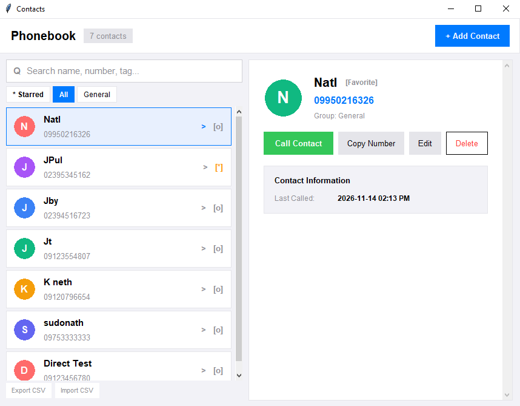

<!-- Packaging: Standalone Desktop EXE and Android APK builds supported -->
# Contact Search Application

A modern, responsive centralized phonebook application that searches and ranks contact numbers, names, and tags using the **Dynamic Programming Levenshtein Distance (Edit Distance)** algorithm.



## Overview

The application is built on a clean **Model-View-Controller (MVC)** architecture with a dedicated **DSA Processing Engine**:
- **Model (`src/data/`)**: Pure Python persistence and entity validation for `contacts.json`.
- **View (`src/ui/`)**: User-friendly, responsive presentation layer with dual-pane desktop view and single-pane mobile reflow.
- **Controller (`src/ui/contact_controller.py`)**: Coordinates data flow between UI, algorithms, and persistence.
- **DSA Engine (`src/dsa/`)**: Isolated Levenshtein Distance Dynamic Programming algorithm with zero 3rd-party dependencies.

For complete architectural diagrams, sequence workflows, and complexity specifications, see [docs/SYSTEM-DESIGN.md](docs/SYSTEM-DESIGN.md).

## Key Features

- **Fuzzy Search & Ranking**: Matches names, numbers, and department tags using Levenshtein distance ($O(m \times n)$).
- **Responsive Layout**: Dynamically reflows between dual-pane Desktop view and single-pane Mobile view.
- **Full CRUD Management**: Add, update, view, and delete contacts with validation and duplicate detection.
- **Call & Clipboard Actions**: One-click calling simulation and clipboard copying with timestamp tracking.
- **Category Filter Chips**: Fast filtering by starred favorites and dynamic department tags.
- **CSV Data Exchange**: Export and import directory backups directly from the footer.
- **Cross-Platform Ready**: Pre-configured standalone executable (`dist/Phonebook.exe`) and Android build pipeline (`buildozer.spec`).

## How It Works

- Type a contact name, phone number, or tag into the search bar.
- The app computes the Levenshtein edit distance between your input query and all stored contact records.
- Results are ranked and sorted by algorithmic relevance.
- Computational time complexity: **O(m * n)**, where `m` and `n` are the lengths of the strings being evaluated.

## Technologies Used

- Python 3.12 (Standard Library)
- Tkinter (Native GUI Presentation)
- PyInstaller (Standalone Desktop Executable packaging)
- Buildozer (Android Mobile APK pipeline)

## Quick Start

### Running from Source
Run the application directly using Python:

```powershell
python main.py
```

### Running the Standalone Executable (.EXE)
Launch the pre-built Windows standalone executable directly without needing Python installed:

```powershell
dist\Phonebook.exe
```

Or rebuild anytime by running `scripts\build_exe.bat`.

## Contributors

Students of **College of Mary Immaculate**  
Bachelor of Science in Computer Science - BSCS 2-A

- [Faborada, Nathaniel F.](https://github.com/nathanielfaborada)
- [Bodino, John Paul P.](https://github.com/johnpaul-bodino)
