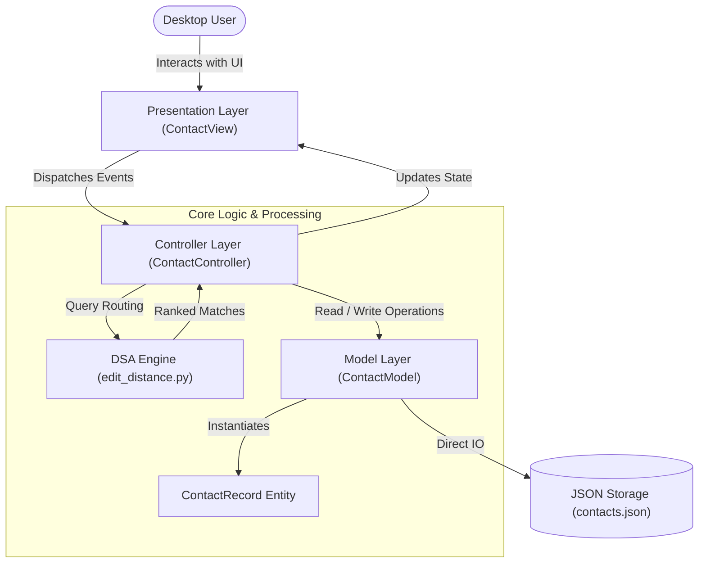
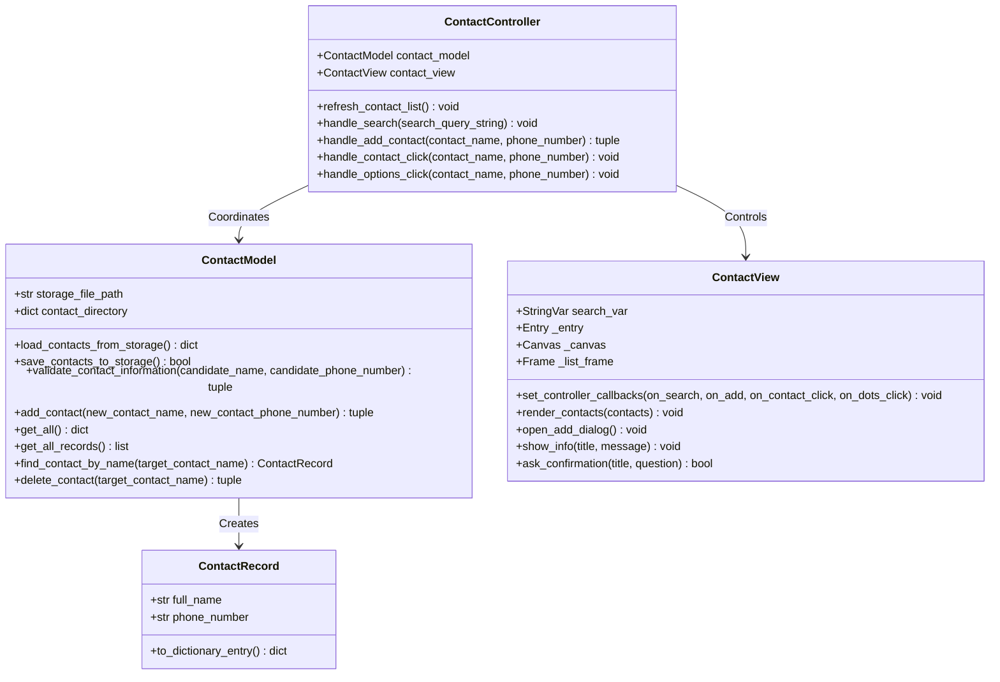
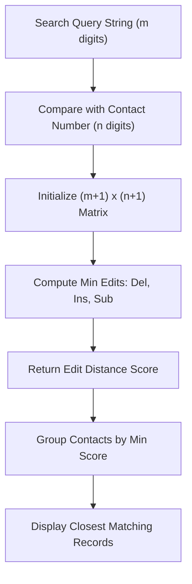
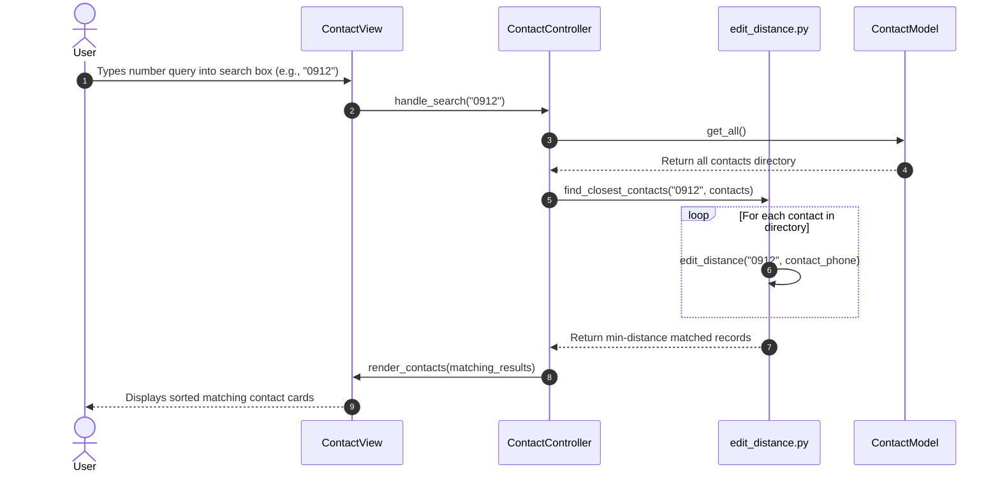
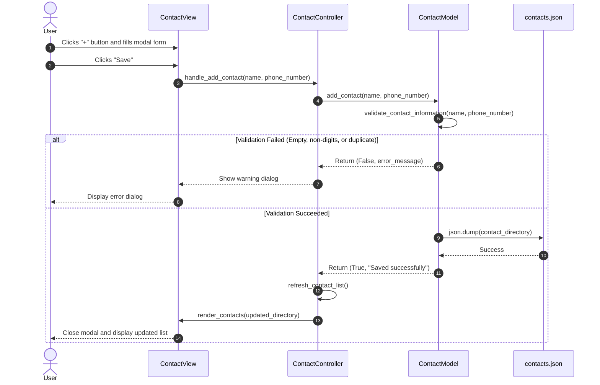

# System Design Document: Contact Search Application

> **Project**: Contact Search Application  
> **Authors**: Nathaniel F. Faborada & John Paul P. Bodino (College of Mary Immaculate - BSCS 2-A)  
> **Architecture Pattern**: Model-View-Controller (MVC) with Dedicated DSA Processing Engine  
> **Runtime Environment**: Python 3 (Native Standard Library) + Tkinter GUI  

---

## 1. High-Level Architectural Overview

The Contact Search Application uses a decoupled Model-View-Controller (MVC) architecture with a standalone Data Structures and Algorithms (DSA) processing engine. The system enforces strict separation of concerns:

- **Frontend / Presentation Layer (`src/ui/`)**: Handles rendering, window lifecycle, layout frames, and user input events via Tkinter.
- **Controller / Orchestration Layer (`src/ui/contact_controller.py`)**: Intercepts user gestures, executes query routing, delegates validation to the Model, and triggers algorithmic filtering.
- **DSA Processing Engine (`src/dsa/`)**: Houses algorithmic logic including Levenshtein Distance (Dynamic Programming) with zero UI or persistence dependencies.
- **Backend / Data Layer (`src/data/`)**: Enforces data integrity rules, encapsulates contact entities, and handles disk persistence to `contacts.json`.



---

## 2. Model-View-Controller (MVC) Class Architecture

The object-oriented design is organized into distinct classes with explicit boundaries:



### Component Roles & Boundary Matrix

| Component | File Path | Scope & Permitted Actions | Strictly Prohibited Scope |
| :--- | :--- | :--- | :--- |
| **ContactRecord** | `src/data/contact_entity.py` | Encapsulates single contact data fields and formatting. | Cannot read disk, call UI, or execute search algorithms. |
| **ContactModel** | `src/data/contact_model.py` | File I/O (`contacts.json`), validation, CRUD operations. | Banned from importing Tkinter or managing UI widgets. |
| **EditDistance DSA** | `src/dsa/edit_distance.py` | Levenshtein matrix calculations, closest match scoring. | Pure mathematical computation; no state retention or I/O. |
| **ContactView** | `src/ui/contact_view.py` | Tkinter widgets, event bindings, card layouts. | Banned from altering `contacts.json` or computing distances directly. |
| **ContactController** | `src/ui/contact_controller.py` | Orchestrates data flow between View, Model, and DSA. | Does not construct visual widgets or read raw disk files. |

---

## 3. Data Structures & Algorithms (DSA) Engine

### Levenshtein Distance (Edit Distance)
The core searching feature computes the minimum single-character edit operations required to convert a search query string `s1` into a stored contact number `s2`.

#### 1. Operations Allowed:
- **Insertion**: Adding a character (`cost = 1`)
- **Deletion**: Removing a character (`cost = 1`)
- **Substitution**: Replacing one character with another (`cost = 1` if different, `cost = 0` if identical)

#### 2. Dynamic Programming Recurrence Relation:
For a 2D matrix `dp[i][j]` representing the edit distance between prefix `s1[0..i-1]` and `s2[0..j-1]`:

$$\text{dp}[i][j] = \begin{cases} 
i & \text{if } j = 0 \\
j & \text{if } i = 0 \\
\text{dp}[i-1][j-1] & \text{if } s1[i-1] == s2[j-1] \\
1 + \min(\text{dp}[i-1][j], \text{dp}[i][j-1], \text{dp}[i-1][j-1]) & \text{otherwise}
\end{cases}$$

#### 3. Complexity Analysis:
- **Time Complexity**: **O(m * n)** per comparison, where:
  - `m` = length of the input search query string
  - `n` = length of the stored contact phone number
- **Total Search Time**: **O(k * m * n)**, where `k` is the total number of contacts stored in `contacts.json`.
- **Space Complexity**: **O(m * n)** for the Dynamic Programming matrix table.



#### 4. Algorithmic Roadmap for Future Expansion:
The `src/dsa/` directory is architected to allow adding further algorithms without breaking the UI or Model:
- **Trie (Prefix Tree)**: For instant O(L) prefix lookup on contact names.
- **Fuzzy Wuzzy / Jaro-Winkler**: For typo-tolerant alphanumeric name search.
- **Soundex / Metaphone**: For phonetic search (e.g. finding "Nathan" when searching "Nathen").

---

## 4. Runtime Sequence Workflows

### Workflow A: Real-Time Phone Number Search



---

### Workflow B: Adding a New Contact



---

## 5. Data Persistence & Storage Contract

### Storage Format (`contacts.json`)
The application uses a key-value JSON schema stored locally in the project root:

```json
{
    "Natl": "09950216326",
    "JPul": "02395345162",
    "Jby": "02394516723",
    "Jt": "09123554807",
    "Vnalo": "09121215376",
    "K neth": "09120796654",
    "Faborada, Nathaniel F.": "09123456789"
}
```

### Data Validation Invariants:
1. **Name Integrity**: Must not be empty or whitespace only. Must be unique within the directory.
2. **Phone Number Integrity**: Must not be empty, must consist exclusively of decimal digits (`0-9`).
3. **Atomic Persistence**: Every mutation (`add_contact`, `delete_contact`) immediately executes a flush to `contacts.json`.

---

## 6. Design System & Ergonomics Standards

All graphical interface tokens strictly align with the project design system in `.agents/design-system/`:

### Color Palette (iOS Light Card Theme)
- **Canvas (`BG`)**: `#F2F2F7` (Neutral light canvas)
- **Card Surface (`CARD_BG`)**: `#FFFFFF` (Elevated card background)
- **Dividers (`DIVIDER` / `SEARCH_BG`)**: `#E5E5EA` (Subtle structural borders)
- **Primary Text (`TEXT_PRIMARY`)**: `#000000` (High contrast text, WCAG AAA compliant)
- **Muted Text (`TEXT_GREY`)**: `#8E8E93` (Secondary metadata text)
- **Accent Color (`ACCENT`)**: `#007AFF` (iOS system blue for primary actions)
- **Accent Active (`ACCENT_HOVER`)**: `#005BBB` (Pressed interaction state)

### Accessibility & Touch Target Enforcement
- **Minimum Interactive Size**: 44x44px touch targets on all interactive controls (Add button, Three Dots menu button, Row selection).
- **Zero Decorative Emojis**: Replaced with clean SVG/Canvas primitives and typography.
- **Anti-Slop Ban**: Absolute ban on em dashes and en dashes across all user-facing dialogs, labels, and documentation.

---

## 7. File Directory Map

```text
contact-search-application/
├── docs/
│   └── SYSTEM-DESIGN.md                # This comprehensive system design manual
├── src/
│   ├── data/                           # Persistence & Domain Entities
│   │   ├── __init__.py
│   │   ├── contact_entity.py           # ContactRecord entity class
│   │   └── contact_model.py            # ContactModel JSON repository & validation
│   ├── dsa/                            # Algorithmic Computation Engines
│   │   ├── __init__.py
│   │   └── edit_distance.py            # Levenshtein distance & ranking logic
│   ├── ui/                             # Visual Presentation & Controllers
│   │   ├── __init__.py
│   │   ├── common/
│   │   │   ├── __init__.py
│   │   │   └── colors.py               # Design tokens (iOS Light Card Theme)
│   │   ├── shared/
│   │   │   ├── __init__.py
│   │   │   └── helpers.py              # Formatting & avatar initial extractors
│   │   ├── contact_view.py             # Tkinter desktop layout & widgets
│   │   └── contact_controller.py       # MVC orchestrator & query dispatcher
│   └── index.py                        # Internal application factory entrypoint
├── main.py                             # Project root launcher
├── contacts.json                       # Contact records database file
├── README.md                           # Project introduction & overview
└── .gitignore                          # Clean repository ignores
```
